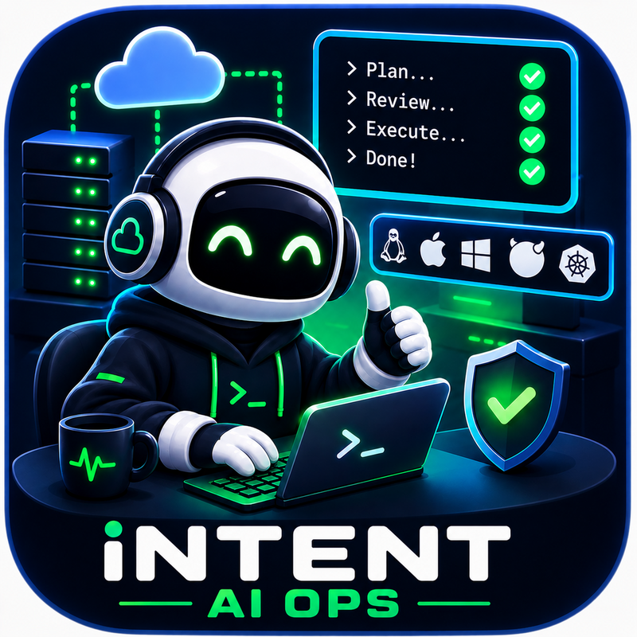
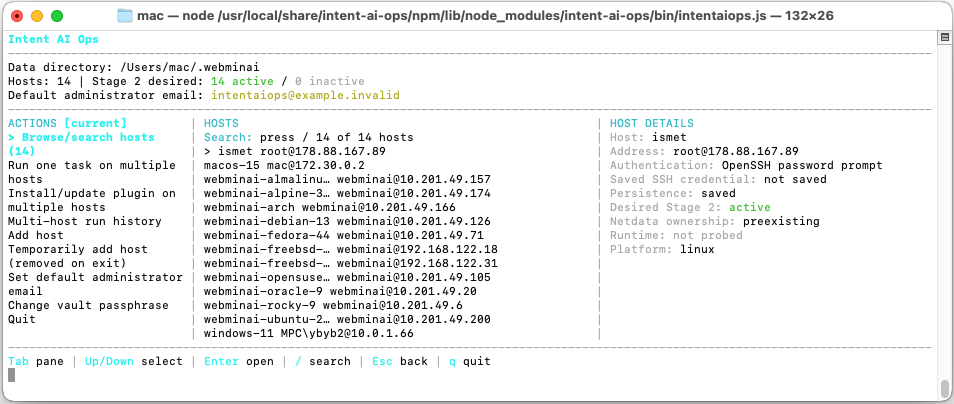

# Intent AI Ops

Application installs include reviewed, read-only security checks and saved recommendations. See [application security checks](docs/software-security.md) for advisory coverage, update review and evidence limitations.

<p align="center">
  <a href="https://intentaiops.top">
    
  </a>
</p>

<p align="center">
  Manage one or many hosts like a system administrator or DevOps engineer, using natural-language instructions.
</p>
<p align="center">
  <a href="https://www.youtube.com/watch?v=i01pbFc0i7A">
    Watch the Intent AI Ops usage example on YouTube
  </a>
</p>
<p align="center">
  
</p>

**Intent AI Ops** is an interactive CLI for administering servers with natural-language tasks. It connects through your system OpenSSH client, asks a local Codex CLI to prepare a structured plan, lets you review that plan, and executes only approved commands through Intent AI Ops's signed Netdata plugin.

No separate AI agent is installed on each controlled host. Detailed technical and agent-facing documentation lives in [AI_AGENT_REFERENCE.md](AI_AGENT_REFERENCE.md).

## What Intent AI Ops can do

- Manage Linux, FreeBSD, macOS, Windows, and Kubernetes targets from one terminal.
- Plan and run administration tasks on one host or several hosts in parallel.
- Inspect platform, monitoring, Docker/Podman, privilege, Netdata, and Stage 2 health.
- Install verified common software using platform-aware, reversible plans.
- Use Netdata for monitoring and inventory, and optionally connect an existing Agent to Netdata Cloud.
- Save task plans, progress, results, retries, and rollback plans in per-host SQLite history.
- Retry a failed task with its earlier evidence, or run its saved revert plan.
- Open a real interactive system SSH shell when manual work is needed.

Multi-host tasks occupy some of the same territory as Ansible or Salt: one operation can target many machines and each host keeps an independent result. Intent AI Ops is not a replacement for declarative configuration management, but its initial learning curve is lower for ad-hoc work—you can describe the desired outcome in ordinary language instead of first writing a playbook or state tree. Commands are still shown before execution.

## Product & Investor Briefings

- [Intent AI Ops Presentation](https://docs.google.com/presentation/d/1w4rTsG3wYAxsDPKX6ervhBBlz102MvCqKcgHplh0rOY/edit?usp=sharing)
- [Intent AI Презентация на русском языке](https://docs.google.com/presentation/d/19EOd5NY-RosAMdxKdQyixe5fQwog5mgVfUKYOnqRZfQ/edit?usp=sharing)
- [Intent AI Ops 演示文稿 — 中文（自动翻译）](https://docs.google.com/presentation/d/1GRATW06DB4FvynuFRn2-7-Tvwa7JVW9hquM9e3prIBk/edit?usp=sharing)

## New capabilities since plugin v0.8.0

Update Intent AI Ops for the CLI/browser features below; remote plugins are updated separately through their host or cluster actions. Plugin and application versions are independent.

Everything above remains available, including CLI multi-host tasks, parallel execution, Netdata monitoring and reviewed reverts. This branch adds more ways to work:

- **Local browser workspace:** manage hosts, follow live resource measurements and arrange tasks side by side. CLI and browser share history and review rules. Choose from 27 themes without changing your workflow.
- **Safer interruption recovery:** reconnect to an existing recorded job, inspect what finished and review continuation without repeating confirmed completed commands. Unknown outcomes are not automatically replayed.
- **More control over multi-host work:** review each host's plan, try a canary before larger batches and continue selected hosts without rerunning successful ones. Existing parallel CLI execution remains available.
- **Security checks and reviewed updates:** tracked PHP and Next.js/React Server Components checks save recommendations. Use **Patch detected security issues** to prepare actual updates for review, not just advice. Native repairs prefer vendor updates; container repairs update or rebuild images. Missing evidence stays unknown. See [security coverage and limits](docs/software-security.md).
- **Recovery from a fresh installation:** discover signed remote common-task records and generate a new reviewed recovery plan for supported task families. This does not run scripts saved on the remote host or make every application eligible for recovery.
- **Expanded platform routes:** qualified FreeBSD Podman application routes and CPU-aware Ghost/MySQL and Magento/OpenSearch image selection on Linux. Existing native routes remain available where supported; platform and runtime checks still decide eligibility.
- **Flexible model selection:** choose models and their supported reasoning levels from your installed Codex CLI. New configurations default to `gpt-6.1-sol` with `low` reasoning; saved choices are preserved.

To try the browser workspace:

```sh
intentaiops --web                     # read-only
intentaiops --web --console-actions   # reviewed host and task controls
```

Unlock the vault in the launch terminal and open the private URL printed there. Keep that terminal open for SSH prompts. The workspace listens only on `127.0.0.1`; opening or refreshing a page does not approve or restart tasks. For manual access, open a host's **terminal** tab and approve **Open SSH shell**. This is separate from managed plan validation and rollback.

The installer URLs below use `main`. To try an unmerged branch, use its source checkout and run `npm run build:web` before `npm link`. See [browser instructions](docs/web-workspace.md) and [execution recovery](#execution-recovery-and-operator-console) for the full workflows.

## Current verified common tasks

Application routes currently in the catalog:

| Application | Linux without Docker | Linux Docker Compose | FreeBSD | Windows Docker | macOS Colima | Kubernetes |
| --- | --- | --- | --- | --- | --- | --- |
| WordPress | Yes | Yes | Yes | Yes | Yes | Yes |
| WooCommerce | Yes | Yes | Yes | Yes | Yes | Yes |
| Joomla | Yes | Yes | Yes | Yes | Yes | Yes |
| Drupal | Yes | Yes | Yes | Yes | Yes | Yes |
| PrestaShop | Yes | Yes | Yes | Yes | Yes | Yes |
| Moodle | Yes | Yes | Yes | Yes | Yes | Yes |
| Nextcloud | No | No | Yes | No | No | No |
| Magento Open Source | No | Yes | Yes | Yes | Yes | Yes |
| n8n | Yes | Yes | Yes | Yes | Yes | Yes |
| Ghost | Ubuntu only | Yes | Yes | Yes | Yes | Yes |
| Mattermost | Debian/Ubuntu and EL9 | Yes | Yes | Yes | Yes | Yes |
| Odoo Community | Ubuntu only | Yes | Yes | Yes | Yes | Yes |
| Jellyfin | Debian/Ubuntu and supported glibc distros | Yes | Yes | Yes | Yes | Yes |
| Home Assistant | No | Yes | Yes | Yes | Yes | Yes |
| Intent AI Ops CLI | Host-native | Host-native, not Compose | Host-native | Host-native, not Docker | Host-native, not Colima | No |

Ghost's Linux Docker task prefers the pinned MySQL 8.4 official image. On x86-64 CPUs that demonstrably lack x86-64-v2, it builds a task-specific Debian image from checksum-pinned MySQL 8.4 vendor packages instead. Unknown CPU capabilities stop preparation before task files or credentials are created. Existing Ghost data is never adopted or downgraded. See [image sources and limitations](docs/ghost-mysql-images.md) and the [official MySQL image CPU limitation](https://github.com/docker-library/mysql/issues/1055).

Magento's Linux Docker task also keeps the official OpenSearch image as default. Older x86-64 CPUs select a pinned Debian/Java 21 build of the official minimal OpenSearch archive, without optional vector plugins. Unknown CPU capabilities stop preparation. See [image selection, search checks and limitations](docs/magento-opensearch-images.md).

Platform and maintenance tasks:

| Platform | Runtime setup | Diagnostics and maintenance | Other verified tasks |
| --- | --- | --- | --- |
| Linux | Docker Engine and Compose | Host health report; current-release updates | nginx static site; htop; jq; system user; swap file; systemd service; systemd timer; cron; logrotate; tmpfiles |
| FreeBSD | Podman Suite and Compose; FreeBSD supports 14.3+, while Intent AI Ops's bootstrap is currently validated on 15+ | Host health report; current-release updates | — |
| Windows | WSL 2 and Docker Desktop | Host health report; current-release updates | Brave Browser |
| macOS | Colima and Docker Compose | Host health report | — |
| Kubernetes | Uses the existing cluster runtime | — | nginx static website |

This is catalog support, not a promise that every task fits every machine. Intent AI Ops shows only tasks eligible for the detected OS version, distro, service manager, package sources, architecture, virtualization, container environment, and runtime policy. For example, systemd tasks require systemd, swap is hidden inside containers, and Kubernetes tasks do not install a container runtime or agent on every node.

### When Docker or Podman is preferred

The default preference is **Automatic**:

| Target | Preferred route |
| --- | --- |
| Linux server or VM | Docker Compose; Intent AI Ops offers Docker setup when needed |
| Linux container | Native installation; nested Docker stays off |
| Windows | Linux-container Docker Desktop through WSL 2 |
| macOS | Docker Compose through Colima |
| FreeBSD 14.3+ outside a jail | Podman Suite and Podman Compose; current Intent AI Ops application validation may require 15.1 |
| Kubernetes | Kubernetes API workloads; Docker/Podman preference is not used |

- **Automatic:** follows the table and uses a reviewed native route when containers are unsuitable.
- **Enabled:** explicitly requests the container route. Platform, virtualization, and jail/container safety checks still run.
- **Disabled:** uses reviewed native routes only and hides tasks that require Docker, Podman, or Colima.

Native Linux web stacks prefer nginx and PHP-FPM Unix sockets. Container credentials are generated on the host and stored in protected files, never in AI context or task history.

FreeBSD Odoo, Home Assistant and Magento can install their native stack inside
a task-owned Podman container, not a Linux Docker image. **Automatic** prefers
these verified routes on ready amd64 FreeBSD 14.4 and 15.1 RELEASE hosts. **Disabled**
keeps native installation. Other targets and applications remain explicit
**Enabled** candidates until qualification finishes. Credentials stay in the
protected task directory; application data persists in the container writable
layer. Reviewed rollback deletes both.
FreeBSD containers use `restart=always` for the native boot service, so a manually
stopped container can start again after reboot. Reviewed rollback removes it.
The [upstream FreeBSD port remains experimental](https://podman.io/docs/installation#installing-on-freebsd).

On the validated FreeBSD 14.4/15.1 amd64 hosts, Automatic selects Podman for
WordPress, WooCommerce, Joomla, Drupal, PrestaShop, Moodle, Nextcloud, Odoo,
Home Assistant, Magento, n8n and Jellyfin when their reviewed runtime is ready.
Ghost and Mattermost also select Automatic on independently qualified 15.1.
Ghost and Mattermost on 14.4 have explicit Enabled
Podman candidates pending live qualification. Disabled retains native routes.
The n8n Podman route checks for 8 GiB available on its storage filesystem
before reserving resources. Cold-build space includes LLVM, npm caches and
unpacked dependencies, not just the final application.
Its qualification covers private service health, SQLite persistence, service
and container restart, a public health marker and reviewed rollback, not the
workflow UI or owner onboarding.
Intent AI Ops itself
installs on the host. Platform and runtime safety checks still apply.

## Usage

Run Intent AI Ops on the administration computer. Requirements:

- System `ssh` and `scp` binaries.
- An installed and authenticated Codex CLI. A ChatGPT/Codex subscription is recommended; Intent AI Ops itself does not require a separate OpenAI API key.
- Working SSH access to each target. Stage 2 installation also needs an administrator/root account, sudo, or doas.

Install Codex using the [official Codex CLI instructions](https://learn.chatgpt.com/docs/codex/cli), run `codex`, and sign in. Then use the bootstrap installer; it provides Node.js 24 when needed:

```sh
curl -fsSL https://raw.githubusercontent.com/cryptofuture/intentaiops/main/scripts/install.sh | sh
```

On Windows PowerShell:

```powershell
irm https://raw.githubusercontent.com/cryptofuture/intentaiops/main/scripts/install.ps1 | iex
```

Kubernetes uses its own direct API flow—no SSH server or plugin on every node is needed:

1. From the main dashboard, choose **Add Kubernetes cluster** and enter a cluster name.
2. Choose **Paste kubeconfig YAML (hidden)** or **Read kubeconfig from a local path**. The kubeconfig must contain embedded CA data and either embedded client certificates or a token.
3. Intent AI Ops tests the selected context, API version, and node access before saving the kubeconfig vault-encrypted.
4. Choose **Browse Kubernetes clusters**, open the cluster, then choose **Activate/update Stage 2 gateway**.

The ordinary **Add host** action remains for SSH hosts.

If Node.js 24.7+ and npm are already installed, install the committed package:

```sh
npm install --global https://raw.githubusercontent.com/cryptofuture/intentaiops/main/dist/intent-ai-ops.tgz
```

Or install directly from the current branch:

```sh
npm install --global https://github.com/cryptofuture/intentaiops/archive/refs/heads/main.tar.gz
```

Traditional checkout:

```sh
git clone https://github.com/cryptofuture/intentaiops.git
cd intentaiops
npm i
npm link
intentaiops
```

Update an installation from the official repository, then start the new version:

```sh
intentaiops --update
```

The updater downloads the package and its published SHA-256 checksum, verifies the archive, runs the same platform bootstrap used for installation with that verified archive, replaces the local Intent AI Ops package, and exits. It does not update or reinstall Stage 2 plugins on managed hosts. You can also rerun the original installation command manually. Data is stored in `~/.intentaiops`; an existing `~/.webminai` vault is reused automatically. Select another directory with:

```sh
intentaiops --data-root /absolute/path
```

The first run creates a vault and asks for a passphrase of at least 12 characters. Prefer five or more random words, or at least 20 password-manager-generated characters; length alone does not make a predictable password strong.

The dashboard also lets you set one global administrator email. Verified application installers use it where software requires an initial administrator or contact address—for example, the WordPress administrator account, WooCommerce store contact, or another application's setup email. Relevant AI-planned tasks receive the same preference. The value is vault encrypted and is never used as an SSH username, host identifier, or Netdata identity. If no email is configured, Intent AI Ops uses the intentionally non-deliverable `intentaiops@example.invalid` fallback.

The default is **`gpt-6.1-sol` with `low` reasoning**. Choose **Set Codex model** on the dashboard to load your installed Codex CLI's model catalog, including hidden entries, and select from that model's supported reasoning levels. Catalog presence does not guarantee account access or provider capacity. `mimo-v2.6-pro` also supports selection with `low`, `medium`, or `high` through your configured local `mimo` profile; its responses are validated against the JSON schema locally. Settings are saved for subsequent tasks; existing saved selections are preserved. If discovery fails, settings remain unchanged. Model discovery requires a Codex version supporting `codex debug models`.

Choose **Controls** to configure wrapping menu navigation, optional `j`/`k` navigation, number shortcuts, shortcut hints, and automatic/color/monochrome output. These preferences are also saved in `settings.json`.

If another CLI or console saves settings, a stale instance will ask you to restart instead of overwriting those changes. Restart all running instances after upgrading to this protection. Existing vaults and host configurations remain compatible.

## SSH and secret protection

- **Codex runs locally.** Intent AI Ops uses your signed-in Codex CLI directly, so it needs no separate OpenAI API key.
- **Secrets stay protected.** SSH connections and saved credentials are encrypted in a strong local vault. Saving an SSH password or key passphrase is optional and disabled by default. One-time sudo passwords are never saved.
- **AI receives no secrets.** Sensitive values are removed from inventory, diagnostics, logs, and task history before context reaches Codex. The AI never receives your vault, SSH credentials, connection strings, private keys, tokens, or generated application passwords.

Intent AI Ops uses the system OpenSSH client. Temporary hosts disappear when Intent AI Ops exits, while their task history can be safely reattached if the same machine is added again.

## Giving tasks and using history

Add a saved or temporary host by giving it a name and pasting the SSH command that already works for you, for example:

```text
ssh -p 2222 -i ~/.ssh/edge admin@edge.example.com
```

Connect to the host, activate Stage 2 or install/update only its plugin, then choose an AI-assisted or verified task.

Write tasks naturally:

```text
Install nginx and serve a health page on port 8080
```

Prefix a request with `?` to consult Codex without proposing, approving, or executing commands:

```text
? Why is host memory usage increasing, and what should I inspect first?
```

Before execution, Intent AI Ops shows the complete plan, warnings, files and paths, commands, dependencies, and saved revert commands. You can approve the whole displayed plan, review commands individually, or cancel. Approval defaults are conservative.

Task history is the per-host audit trail of requests, Codex progress, plans, command output, errors, retries, and reverts. Open **Task history and reverts**, select a task, then choose:

- **Retry with automatic corrections from history** to let Codex use the previous failure evidence.
- **Retry with additional correction instructions** to add your own guidance.
- **Run the saved revert plan** to execute the reviewed rollback commands.

Retries create new records and never overwrite the original task. Multi-host runs group separate per-host tasks, allowing failed hosts to be cleaned up and retried without rerunning successful hosts.

## Execution recovery and operator console

Intent AI Ops records execution progress so you can inspect interrupted work and continue without repeating confirmed completed commands. You stay in control: AI suggestions never execute without your approval.

If SSH drops during execution, recovery tries to reconnect up to three times, waiting 1 then 2 seconds between attempts. For a recorded background job, it checks that same job rather than starting it again. Progress shows when it is reconnecting, when the job is still running, and when operator review is needed. After recovery, remaining commands stay paused until you review and approve continuation. If the result cannot be confirmed, investigate the host before resuming.

Failure details now separate **what happened** from **why it may have happened**. Reports identify confirmed timeouts, cancellation, transport errors and explicit resource errors, plus suspected causes such as a new OOM kill in the host's cgroup. Evidence appears in task history, recovery, console events and diagnostic exports. A suspected cause never confirms a command's outcome or authorizes a retry. Available evidence varies by platform; see [diagnostic coverage and limits](docs/execution-diagnostics.md).

### Recover or change a task

1. Open **Task history and reverts**, select the task, then choose **Operator controls** or **Inspect durable execution and recovery**. An unfinished task may still be active in another session.
2. Inspect what completed and what remains. If a connection was lost, use **Reconcile durable remote outcomes** to check recorded remote jobs. If the outcome is still unknown, investigate the host before continuing. Do not assume the command failed or rerun it blindly.
3. Choose **Review and resume** to continue, or **Revise remaining steps** to change the plan. Review the differences, approve the replacement, then resume. Completed commands stay unchanged.

Use **Review a pending plan revision** to reopen a proposal you did not approve earlier. Approval leaves execution paused; **Review and resume** is a separate step.

If a Linux, FreeBSD or Windows application failed and its catalog recipe has been
fixed, choose **Refresh remaining native Linux catalog steps** or **Refresh
remaining native FreeBSD catalog steps**, or **Refresh remaining Windows catalog steps**. This rebuilds remaining
steps from local catalog code without an AI call. Review the new plan, approve,
then resume. It preserves completed commands and the original rollback, and
refuses uncertain work or incompatible catalog changes. This requires local task
history; it is not fresh-install remote recovery.

Windows Docker setup supports the same reviewed refresh after download polling expires. It continues the existing BITS transfer without repeating completed installers.

For example: “Use port 8080 instead of 80 for the remaining deployment steps.” You can also ask Codex a read-only question, abort remaining work, or review a rollback. A partly completed task needs a separately reviewed rollback proposal.

To pause during a single-host task, enable **intervention at command boundaries** after reviewing the plan. Pausing stops before the next command; it does not kill a command already running.

### Recover a common task from another installation

New verified common-task runs also write signed, secret-free records on the
managed host. From another installation, add the same host, connect normally,
and authorize Stage 2 through the usual plugin activation flow if needed. Then
choose **Remote common-task recovery**. Select an execution to verify its
signature and host identity, then request a newly generated recovery plan.
Review and approve that plan before anything changes.

The audited recovery profiles cover the Linux systemd service, timer, logrotate
and tmpfiles fixtures, plus native Intent AI Ops CLI installation on non-Alpine Linux.
Windows CLI installations also support reviewed fresh-install recovery when their
signed records contain the protected ownership baseline. Changed files, unsafe
paths, old records without that evidence and other Windows task families remain
ineligible. The Windows lab verified installation, fresh-profile review and exact
trusted-probe restoration without repeating completed commands.
Native n8n has an additional guarded recovery profile with fixture coverage
and a reviewed Debian lab recovery.
The CLI-install profile has fixture coverage and a reviewed Debian lab recovery.
Other task families can be recorded but cannot yet use verified remote
rollback. Changed catalogs, missing or modified baseline files, partial execution
and unknown outcomes block that recovery path. Windows signed storage and
read-only fresh-profile verification passed the lab checks, including tampered
records and wrong-host rejection. Destructive Windows recovery is limited to the
CLI profile above. Kubernetes has a separate resource-bound recovery
path: enable a dedicated persistent PVC during gateway activation, then use the
cluster task workspace to prepare, review and execute catalog plans. CLI and web
share durable history. Remote discovery verifies signatures and regenerates a
new UID-checked recovery plan; it never runs a saved remote script. The kind lab
passed an n8n browser cycle, gateway restart and fresh-profile reviewed recovery
without RBAC expansion. See [Kubernetes recovery](docs/remote-common-task-recovery.md#kubernetes-cluster-workspace).

Keys stay on the host; normal verified SSH establishes the public-key pin. A
changed pin is refused. The recovery menu also offers explicitly reviewed key
rotation, retaining public keys so older records still verify. Completed sources
with abandoned ownership need separate takeover approval; partial or unknown
work stays blocked. These signatures do not protect against compromised host
administrators or prove that a fresh installation received the newest records.
See [implementation coverage and limits](docs/remote-common-task-recovery.md).

### Open the browser console

```sh
intentaiops --web                     # read-only workspace
intentaiops --web --console-actions   # reviewed task and host controls
intentaiops --web --console-actions --web-port 4317
# intentaiops console [--console-actions] remains compatible
```

1. Run either command and unlock your vault in the terminal.
2. Open the printed URL for host navigation, task panes, monitoring, activity and 27 themes. Appearance persists in the local profile, including read-only mode.
3. With actions enabled, explicitly select targets and prepare a task. Review its saved plan before execution. Pause, revise, resume and rollback remain separately reviewed; SSH and elevation prompts stay in the launch terminal.
4. For a direct interactive shell, open a host's **terminal** tab and approve **Open SSH shell**. This is operator-controlled SSH outside managed plan validation and rollback; terminal traffic is not saved or sent to AI. End the session explicitly before starting other changes on that host.

The console is local-only (`127.0.0.1`). Keep its launch URL private. Replay and diagnostic exports only read history, never run commands. Raw command output is withheld from browser views and exports; inspect it in local task history.

Keep the foreground process open. Closing a pane or refreshing the page never
cancels or restarts work. Read [workspace instructions](docs/web-workspace.md)
for launch ports, host identity, staged runs, themes, shutdown and build details.

For several hosts, choose a **staged canary rollout** to try one host first, then continue in batches of two. Verify health after each stage. Failures or missing verification stop further stages; you can inspect and safely resume selected hosts without repeating successful ones.

If repairs keep failing without progress, Intent AI Ops asks for a different strategy before another attempt. Older tasks without execution records cannot be resumed automatically. See [execution milestone details](docs/execution-milestones.md) for configuration, safety limits, and live-host testing notes.

## Development

```sh
npm test
npm run lint
npm run typecheck
npm run test:package-install
```

Intent AI Ops's verified common tasks are learned and promoted through disposable Linux distro containers, FreeBSD VMs, Windows and macOS hosts, and Kubernetes labs. A candidate is exercised through apply, health verification, restart recovery, revert, and baseline comparison. Platform and package-family differences become reviewed deployment foundations so later tasks need less AI-generated infrastructure and have a better first-pass success rate.

The catalog covers common administration and application workloads. Eligibility is resolved from the actual platform, distro, runtime, virtualization, and Docker/Podman preference; unsupported tasks should not be offered. See [top-20-cross-platform-codex-tasks.md](top-20-cross-platform-codex-tasks.md) and the detailed [AI agent reference](AI_AGENT_REFERENCE.md) for the validation workflow.

## Contributing

Keep pull requests narrow:

- Include only changes required for the stated fix or feature.
- Prefer one feature, one software candidate, or one platform-support addition per PR.
- Do not mix unrelated refactors, formatting, dependency updates, or generated artifacts.
- Add focused automated tests and, when behavior reaches a real host, document the live validation performed.
- Preserve approval, rollback, history compatibility, system OpenSSH, and secret-redaction guarantees.

Finally, the author would prefer not to be killed by an admin who thinks AI stole their job. Intent AI Ops is intended to remove repetitive work and improve admin productivity. Similar tools will appear anyway; making one reviewable, auditable, and reversible is the useful part.

## License

Copyright 2026 Intent AI Ops <admin@intentaiops.top>.

Licensed under the [Apache License 2.0](LICENSE).
